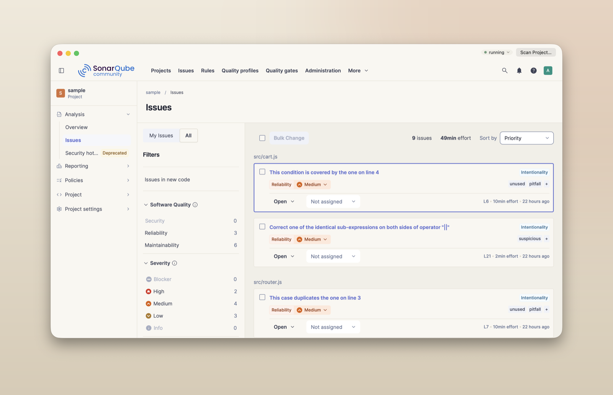
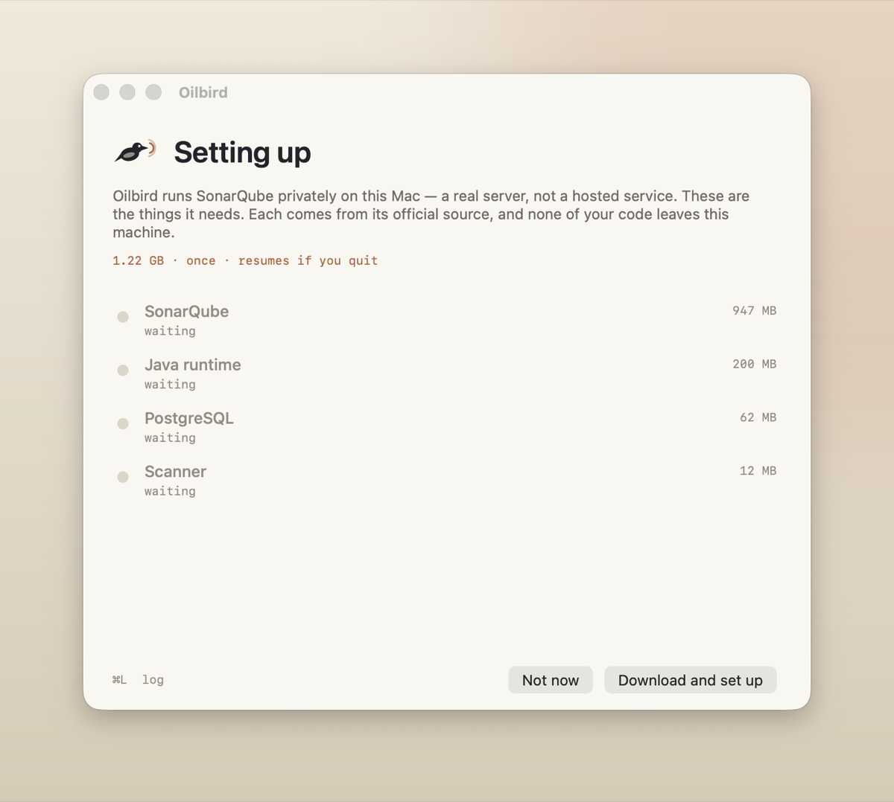
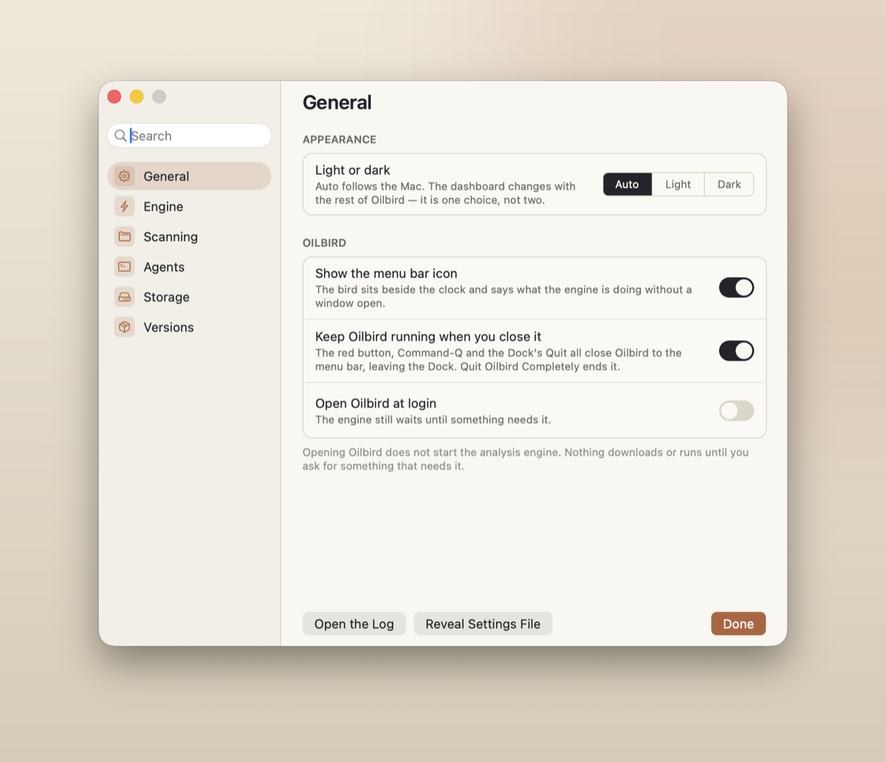
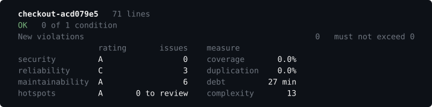
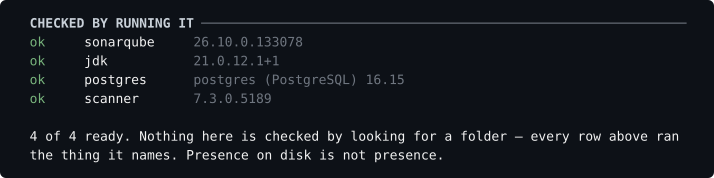
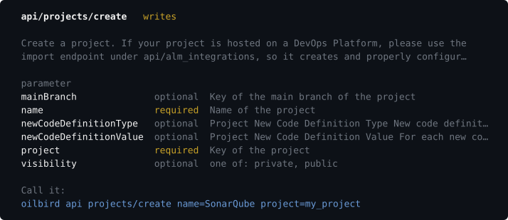

<h1 align="center">Oilbird</h1>

<p align="center"><strong>A private SonarQube on your Mac. Nothing to install first.</strong></p>

<p align="center">
  <a href="LICENSE"></a>
  
  
</p>

<p align="center">
  
</p>

## What it is

**Oilbird gives you SonarQube's code analysis without Docker, Homebrew or a server.**
Most code quality tools want a Docker daemon before they want anything else. Oilbird
wants a double click.

On first launch it downloads a JDK, a PostgreSQL cluster, a
[SonarQube Community Build][sq] server and the scanner, 1.22 GB in all, keeps every byte
of it inside its own container under `~/Library`, and supervises the lot. Your code stays
on your machine, and so do the database, the dashboard, every result and every token.

- **Nothing to set up.** Every dependency is fetched from its own official source and
  checked against a pinned SHA-256 before it is unpacked.
- **It sleeps.** The engine starts when a command needs it, in about fifteen seconds, and
  stops itself after thirty idle minutes. You never start or stop it yourself.
- **One core, three ways in.** The app, a command line and an MCP server for agents all
  run the same code, so a button and a verb cannot disagree about your code.
- **The whole API.** `oilbird api` reaches every call the running server offers, read
  off the server itself.

> Named for *Steatornis caripensis*, the oilbird: one of two bird species that navigate in
> total darkness by echolocation.

## Installation

You need a Mac with Apple silicon, **macOS 15 or later**, and Xcode's Command Line Tools.
No Homebrew, Node, Python, Docker or Apple Developer account.

**Build it yourself. It is two commands, and it is the recommended way:**

```sh
git clone https://github.com/birdtable/oilbird
cd oilbird
make app                         # builds dist/Oilbird.app
cp -R dist/Oilbird.app /Applications/
```

An app you built on your own Mac is not quarantined, so it opens with a double click and
macOS asks you nothing.

<details>
<summary><strong>Using the release build instead</strong></summary>

Each [release](https://github.com/birdtable/oilbird/releases) carries
`Oilbird-<version>.zip` with its SHA-256 beside it.

Oilbird is signed ad-hoc rather than with a paid Apple Developer certificate, so the first
time you open a downloaded copy macOS refuses and says it cannot check it for malicious
software. To open it once:

1. Double click it. macOS refuses. Dismiss the dialog.
2. Open System Settings, go to Privacy & Security, and scroll down.
3. Click **Open Anyway** on the line naming Oilbird, and confirm.

On macOS Sequoia and later, Control-click and Open no longer works for this. The Settings
visit is the only route, and it is once per download.

</details>

## Getting started

Open the app and let the first launch finish. It fetches 1.22 GB once, and that is the
whole of the setup:



Then turn on the command line in Settings, which links `oilbird` into `/usr/local/bin`:

```sh
oilbird doctor                 # does every dependency actually run?
oilbird scan .                 # analyse this directory
oilbird summary <project>      # the gate, the ratings and the counts
oilbird issues <project>       # what it found; --browse to move around in it
oilbird gate <project>         # exits 4 if the quality gate failed
```

`oilbird --help` lists all twenty-two verbs. `oilbird up` and `oilbird down` are there if
you want to start or stop the engine by hand.

## The app

The window is SonarQube's own dashboard, with Oilbird's frame around it saying whether the
engine is up and offering to scan something. There is no second interface to learn. The
picture at the top shows nine real findings in [`docs/sample`](docs/sample), three small
JavaScript files kept here with defects left in on purpose.

Settings tells you what it is doing, rather than making you find out:



Closing the window stops nothing, quitting does, and neither starts a download.

## The command line

**The gate, the ratings and the counts, on one screen:**



**Whether it actually works.** `doctor` runs every dependency instead of looking for its
folder, because a half-unpacked JDK has a folder too:



These screens are captured from the real binary on a real terminal by `make screenshots`.

Screens go to **stderr**; stdout carries `--json` and nothing else. So
`oilbird issues <project> --json > issues.json` is the one you want in a script, and a pipe
stays byte-identical whatever the terminal is doing.

## Every other call

`oilbird api` reaches the whole of the running server's API, some 300 calls across about
fifty services, generated from what the server says it has rather than a list kept here.

```sh
oilbird api                               # every service, grouped
oilbird api qualityprofiles               # one service, and its calls
oilbird api projects/create               # what it takes, and what is required
oilbird api rules/search languages=js ps=5
```

Each call describes its parameters, which are required, their legal values, and a line you
can copy and run:



Not all of them will work: this is Community Build on a laptop, and some calls want a
licence, a cluster or a plugin that is not here. Those say why rather than failing quietly.

## For agents

An MCP server ships inside the app, with fifteen tools that behave exactly like their CLI
verbs:

```json
{
  "mcpServers": {
    "oilbird": {
      "command": "/Applications/Oilbird.app/Contents/Helpers/oilbird-mcp"
    }
  }
}
```

Settings has a pane that writes this snippet with the right path for your install.

## What it is not

Oilbird does not reimplement or re-skin SonarQube's analysis or its web interface. It
provisions and supervises; the analysis and the dashboard are SonarQube's.

Community Build analyses 27 languages, including Java, TypeScript, Python, Go, Kotlin, C#,
PHP, Ruby, Rust and Terraform. Swift is not one of them, so Oilbird cannot analyse Oilbird.

Oilbird is not affiliated with or endorsed by SonarSource S.A. SonarQube is a trademark of
SonarSource S.A.

## Contributing

```sh
make build       # compile, warnings as errors
make test        # the suite; must end "N assertions, 0 failed"
make lint        # swift-format, then every check in oilbird-checks
make coverage    # how much of the product the suite runs, against a floor
make tsan        # the suite again, under the thread sanitizer
make help        # the common targets
```

[CONTRIBUTING.md](CONTRIBUTING.md) has the rest, and [ARCHITECTURE.md](ARCHITECTURE.md) has
the map of the code. Changes are recorded in [CHANGELOG.md](CHANGELOG.md).

## Licence

Oilbird is [GPL-3.0](LICENSE).

Every dependency is downloaded at runtime and never bundled, each pinned by version and
SHA-256 in `manifest.json`. `oilbird version` lists what this build pins and each one's
licence: SonarQube Community Build and the scanner are LGPL-3.0, the Temurin JDK is GPL-2.0
with the classpath exception, and PostgreSQL is under the PostgreSQL licence.

[sq]: https://www.sonarsource.com/products/sonarqube/
